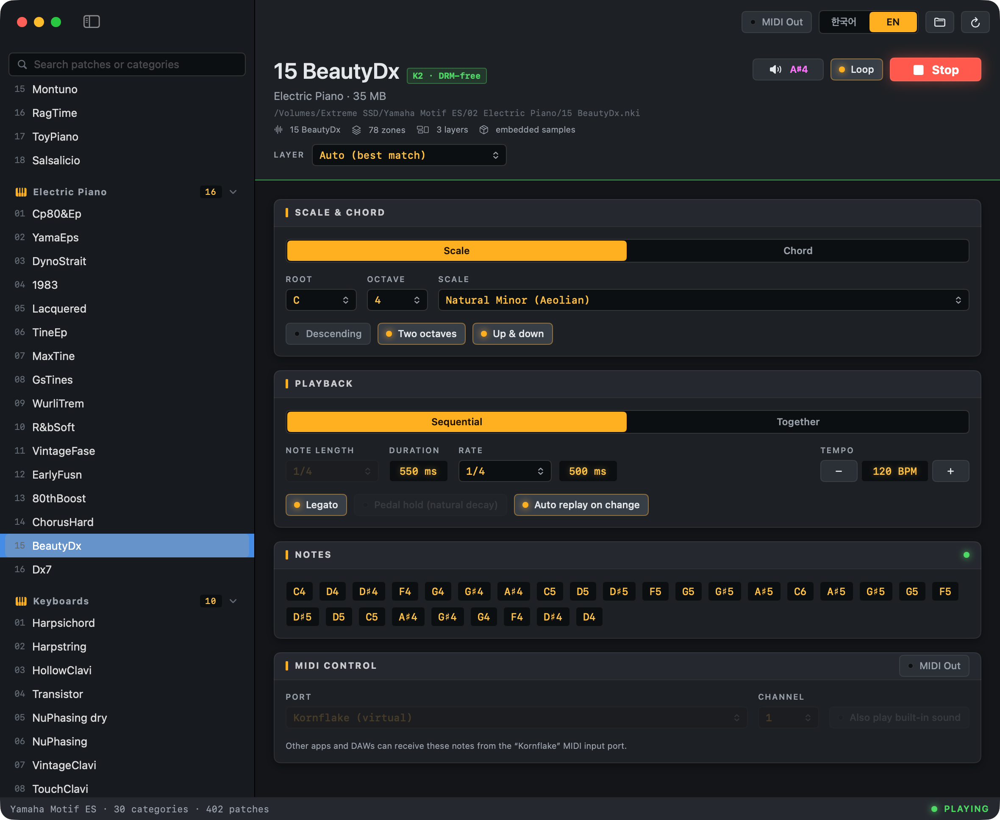

# Kornflake (Yamaha Motif Player)

Yamaha Motif ES Kontakt 악기의 실제 샘플을 Kontakt Player 없이 들어보는 macOS 도구입니다.
악기 폴더 하나를 불러오면 사이드 패널에 카테고리별 패치 목록이 나타나고,
패치를 고른 뒤 근음·스케일·코드를 선택해 순차 또는 동시에 재생할 수 있습니다.
키보드만으로 조작할 수 있도록 단축키를 제공하며, UI는 한국어/영어로 전환할 수 있습니다.



```
Samples/Yamaha Motif ES/            ← 악기 폴더 (git 제외)
  01 Acoustic Piano/01 FullGrand.nki   카테고리 폴더 = 사이드 패널 그룹, .nki = 패치
```

앱은 한 번에 악기 하나만 불러옵니다. 여러 라이브러리를 둘러보는 용도가 아닙니다.

---

## 1. 먼저 확인한 사실

| 구분 | Kontakt Player 없이 재생 |
|---|---|
| 전체 `.nki` | — |
| Kontakt 2/3 (비암호화, zlib XML) | 가능 |
| Kontakt 4.2 (FastLZ 바이너리) | 미지원 |
| Kontakt 5+ (`hsin` 컨테이너, 암호화) | 불가능 |

Kontakt 5+ 파일은 내부 프리셋이 `SUBTREE` + `ENCRYPT` 청크로 암호화되어 있습니다.
예: Alicia's Keys, Noire, Play Series, Session Guitarist, Symphony Essentials 등.
이 도구는 암호화를 해제하지 않습니다. 보호된 악기는 재생할 수 없으며,
패치 목록에는 재생 가능한 패치만 표시합니다.

반면 Kontakt 2/3 세대의 DRM-free 악기는 프리셋이 zlib 압축 XML로 저장되어 있어
샘플 매핑(키 범위, 벨로시티, 루트키, 샘플 경로)을 직접 읽을 수 있습니다.

> 요약: Kontakt Player 없이 실제 음색을 재생하려면 DRM-free K2 계열만 가능합니다.
> 보호된 K5 라이브러리는 정식 Kontakt/Kontakt Player가 필요합니다.

---

## 2. 동작 방식

Kontakt 엔진이나 별도 샘플러를 만들지 않습니다.

1. `.nki` 헤더를 읽어 Kontakt 2/3 / 4.2 / 5+ 형식을 구분합니다.
2. K2 파일의 zlib 스트림을 풀어 `K2_Container` XML을 파싱합니다.
3. 그룹·존에서 키 범위, 벨로시티, 루트키, 튜닝, 볼륨/팬, 샘플 시작/끝, 루프 정보를 읽습니다.
4. NI 경로 인코딩(`@bd016...F00000019000...wav`)을 실제 경로로 디코딩합니다.
5. 모놀리스 `.nki`는 내부 WAV 블록을 캐시로 추출합니다.
6. `AVAudioEngine` + `AVAudioUnitVarispeed`로 샘플을 재생합니다.
   - 44.1 kHz / stereo로 리샘플링
   - 존의 sampleStart/sampleEnd 적용
   - 짧은 fade in/out
   - 24개 보이스 풀

즉, 샘플러 엔진을 새로 설계하지 않고 macOS 기본 오디오 스택 위에
“존 선택 + 샘플 재생 + 피치 변속”만 구현했습니다.

### 스케일 / 코드

- 스케일: Major, Natural/Harmonic/Melodic Minor, Dorian, Phrygian, Lydian,
  Mixolydian, Locrian, Major/Minor Pentatonic, Blues, Diminished (W–H / H–W),
  Whole Tone, Chromatic
- 코드: Major, Minor, Dim, Aug, Sus2, Sus4, Maj7, m7, 7, dim7, ø7, mMaj7,
  6, m6, add9, 9, m9, 7sus4
- 근음 + 옥타브 선택
- 코드 확장(Extend up / Extend down, 각 0–6): 코드의 음 패턴을 이어서 위나 아래에 음을 추가해 음역을 넓힙니다.
  예: C 메이저(C E G)를 위로 2 확장하면 한 옥타브 위의 C E가 더해지고, 아래로 1 확장하면 아래 G가 더해집니다.
  MIDI 범위(0–127)를 벗어나는 음은 버립니다. 코드 모드에서만 적용됩니다.
- 자동 재생(Auto replay on change): 재생 중에 코드, 패턴, 박자, 템포, 레이어, 패치 등을 바꾸면
  잠시(약 0.15초) 뒤 자동으로 멈췄다가 새 설정으로 다시 시작합니다. 기본값은 켜짐이며, 재생 중이 아닐 때는
  아무 일도 하지 않습니다. C4 테스트 중에는 동작하지 않습니다.
- Sequential(순차) / Together(동시)
- Rate(진행 간격): 순차 재생에서 다음 음이 시작되기까지의 간격입니다. 음 길이(Note length)와 별개로 정하며, 음 길이가 간격보다 길면 음이 겹쳐 울립니다.
- 내림차순, 2옥타브, 반복 재생
- 오르내리기(Up & down, `⇧⌘D`): 스케일을 올라갔다가 다시 내려오는 것을 한 사이클로 재생합니다.
  꼭대기 음은 한 번만 연주합니다. 내림차순과 함께 켜면 내려가는 것부터 시작하고, 반복(Loop)을 켜면
  끝 음과 시작 음이 겹치지 않게 끊김 없이 이어집니다. 스케일 모드에서만 적용됩니다.
- Note length: 1/16, 1/8, 1/4, 1/2, 1, 2, 3, 4 (BPM 40–240)
- Pedal hold: 음 길이로 자르지 않고 샘플의 자연 감쇠까지 재생
- Legato(`⌥G`): 순차 재생에서 각 음을 다음 음까지 이어 겹치며 넘깁니다. 아래 "Legato" 항목을 참고하세요.

---

## 3. 빌드 및 실행

요구 사항: macOS 14 이상, Swift 6 툴체인(Xcode 또는 Command Line Tools).

```bash
cd /Users/dp/Repository/kornflake

# .app 번들 생성 후 실행 (GUI/TCC 권한 때문에 번들 실행을 권장)
./scripts/build-app.sh
open Kornflake.app
```

배포용 DMG는 `./scripts/build-dist.sh`로 만듭니다. 앱을 빌드한 뒤 `dist/Kornflake-<버전>-<아키텍처>.dmg`를 만들고
SHA-256을 출력합니다. 버전은 `build-app.sh`의 `CFBundleShortVersionString`을 따릅니다.
같은 이름의 DMG가 이미 있으면 덮어쓰지 않고 멈추며, 덮어쓰려면 `--force`를 붙입니다.
아키텍처는 현재 Mac을 따르고, `--arch x86_64`(또는 `arm64`)로 다른 아키텍처를 크로스 빌드할 수 있습니다.

Homebrew로 설치하려면:

```bash
brew install --cask soomtong/tap/kornflake
```

### 릴리즈와 Homebrew 배포

빌드와 릴리즈는 로컬에서 직접 하고, 나머지는 `.github/workflows/release.yml`이 채웁니다.

1. 로컬에서 `./scripts/build-dist.sh`로 `Kornflake-<버전>-arm64.dmg`를 만들고 검증합니다.
2. 태그 `v<버전>`으로 GitHub 릴리즈를 만들면서 DMG를 첨부해 게시합니다.
   예: `gh release create v0.4.0 dist/Kornflake-0.4.0-arm64.dmg`
3. 게시되면 워크플로가 릴리즈에 없는 아키텍처의 DMG(보통 `x86_64`)를 macOS 러너에서 빌드해 첨부하고,
   [soomtong/homebrew-tap](https://github.com/soomtong/homebrew-tap)의 `Casks/kornflake.rb`를 갱신합니다.

- 이미 있는 DMG는 다시 빌드하거나 덮어쓰지 않습니다. DMG 없이 게시하면 두 아키텍처를 모두 CI에서 빌드합니다.
- 태그의 `Info.plist` 버전이 태그와 다르면 빌드가 실패합니다.
- 기존 릴리즈를 채우려면 Actions → Release → Run workflow에 태그를 넣거나
  `gh workflow run release.yml -f tag=v0.3.0`을 실행합니다. 접미사 없는 `Kornflake-<버전>.dmg`(v0.3.0 이전 이름)는 arm64로 봅니다.
- pre-release는 DMG만 채우고 Homebrew tap은 갱신하지 않습니다.
- 저장소 secret `HOMEBREW_TAP_TOKEN`이 필요합니다. `soomtong/homebrew-tap`에 Contents 쓰기 권한이 있는 토큰입니다.

> `swift run`으로도 프로세스는 뜨지만, 번들 Info.plist가 없어
> 일반 앱처럼 전면 활성화되지 않을 수 있습니다. 위 스크립트를 사용하세요.

첫 실행 시 악기 폴더를 고르는 창이 열립니다. 선택한 경로는 저장되어
다음 실행부터 자동으로 불러옵니다. 저장된 폴더가 사라졌으면 다시 묻습니다.

외장 볼륨의 폴더를 고르면 이동식 볼륨 접근 권한을 요청합니다. Allow를 선택하세요.
권한을 거부했다면 시스템 설정 → 개인정보 보호 및 보안 → 파일 및 폴더에서
Kornflake의 이동식 볼륨 접근을 허용한 뒤 `⌘R`로 다시 스캔하세요.

---

## 4. 사용법

1. 앱을 실행하고 악기 폴더(예: `Yamaha Motif ES`)를 선택합니다.
   다른 폴더로 바꾸려면 툴바의 Choose Folder 또는 `⇧⌘O`를 사용합니다.
2. 사이드 패널에서 카테고리별 패치 중 하나를 고릅니다. 카테고리 헤더에는 아이콘, 번호를 뗀 이름,
   패치 개수가 표시됩니다. 상단 검색창은 패치 이름과 카테고리 이름(영어/한국어 모두)을 거릅니다.
3. 필요하면 Layer에서 레이어를 고릅니다. 아래 "Layer" 항목을 참고하세요.
4. Play C4로 음색을 먼저 확인합니다.
5. Scale & Chord에서 모드·근음·스케일/코드를 정합니다.
6. Chord 모드에서는 Extend up / down으로 코드의 음역을 넓힙니다.
   Sequential / Together, Loop, Note length도 조정합니다.
7. Play(또는 `Space`)로 재생합니다.

### Layer

패치는 여러 레이어(Kontakt 그룹)로 이루어져 있고, Motif 패치에서는 대부분 벨로시티 레이어입니다.
파일 안의 그룹 이름은 `slice #1 (from: SoTrue) #2`처럼 의미가 없어서, 메뉴에는 실제 범위를 표시합니다.
예: `Layer 2 · velocity 40–80 · C0–C8 · 13 zones`

- Auto: 음마다 벨로시티 100에 가장 알맞은 존 하나를 고릅니다.
- 레이어 선택: 선택한 레이어만 재생합니다. 존이 없는 빈 그룹과 릴리스 트리거 그룹은 목록에서 뺍니다.

### Legato

Playback 패널의 Legato 토글(또는 `⌥G`)로 켭니다. 순차(Sequential) 재생에서만 동작하며, 동시(Together)에서는 비활성화됩니다.

- 각 음은 다음 음이 시작된 뒤 50ms 더 울리고, 그 50ms 동안 fade-out되면서 다음 음과 crossfade됩니다.
  음 길이는 진행 간격(Rate) + 50ms로 정해지고, 길이(Duration) 표시에도 이 값이 나옵니다.
- 켜져 있는 동안 음 길이(Note length)와 페달 홀드는 무시하고 비활성으로 표시합니다.
- MIDI 출력에서는 다음 음의 Note On을 먼저 보내고 50ms 뒤에 이전 음의 Note Off를 보냅니다.
  외부 신디사이저의 mono/legato 모드가 이 겹침을 legato로 인식합니다.
- 겹침 길이(50ms)는 지금은 고정값입니다(`Legato.overlap`).

한계는 다음과 같습니다. 이 기능은 Kontakt 라이브러리의 legato 스크립트를 재현하지 않습니다.

- 전환 샘플 없음: Kontakt의 legato는 보통 KSP 스크립트가 음정 간격별로 녹음된 전환 샘플을 트리거합니다.
  이 앱은 스크립트를 읽지 않고, 대상 라이브러리(Motif ES, E-mu, ASR 등)도 전환 샘플이 없는 멀티샘플입니다.
- 어택 재발음: 음마다 해당 존의 샘플을 처음부터 새로 재생합니다. 한 보이스에서 피치만 옮기는 진짜 mono legato가
  아니어서 새 샘플의 어택이 다시 들립니다. 겹침과 crossfade로 끊김만 가립니다.
- 감쇠형 음색: 루프가 없는 피아노·기타·말렛 같은 샘플은 음을 이어도 앞 음이 먼저 줄어듭니다.
  스트링, 패드, 브라스, 리드처럼 지속되는 음색에서 효과가 가장 큽니다.
- portamento(glide) 없음: 음 사이를 미끄러지듯 잇는 피치 이동은 지원하지 않습니다.
- 같은 음 연속: 같은 음이 연달아 나오면 MIDI에서는 이전 음의 Note Off가 새 음을 끊을 수 있습니다.
  현재 스케일·코드 패턴에서는 같은 음이 연속으로 나오지 않습니다.

### 언어

우측 상단의 `한국어 | EN` 토글 또는 `⇧⌘L`(Help 메뉴)로 전환합니다. 선택은 저장되며, 처음에는 시스템 언어를 따릅니다.
UI, 메뉴, 메시지, 스케일/코드/카테고리 이름이 번역되고 패치 이름은 원문 그대로입니다.

### MIDI 출력

재생하는 음을 MIDI로 내보내 외부 악기나 가상 악기로도 들을 수 있습니다.
우측 상단의 MIDI Out 토글(또는 `⌥M`)로 켜고 끕니다. 기본값은 꺼짐이며, 설정은 저장됩니다.

Sound 영역은 좌우로 나뉩니다. 왼쪽은 Layer 선택, 오른쪽은 MIDI control입니다.

- Port: 기본값은 `Kornflake (가상)` 포트입니다. 앱이 `Kornflake`라는 이름의 가상 MIDI 소스를 만들기 때문에
  DAW나 가상 악기가 이 포트를 MIDI 입력으로 선택하면 신호를 받습니다. 목록에는 연결된 외부 인터페이스와
  다른 앱의 MIDI 입력도 나타나며, 고르면 그 포트로 직접 보냅니다. 연결이 끊긴 포트를 저장해 둔 경우에는 가상 포트로 돌아갑니다.
- Channel: 1–16.
- Also play built-in sound(`⌥I`): 켜면 내장 샘플과 MIDI가 동시에 울립니다. 끄면 외부 악기 소리만 들립니다.
- 보내는 메시지: Note On/Off(벨로시티 100), 페달 홀드가 켜져 있으면 CC64(서스테인).
  정지하거나 재생이 끝나면 울리고 있는 음을 모두 끕니다.
- 스케일/코드 재생과 C4 테스트 모두 MIDI로 나갑니다. 음 길이는 내장 음색과 같습니다.

### 단축키

단축키는 메뉴바의 Audition, Patch, Notes, Playback 메뉴(한국어 모드에서는 오디션, 패치, 음, 재생 설정)에 표시됩니다.

| 동작 | 키 |
|---|---|
| 언어 전환 | `⇧⌘L` |
| 재생/정지 토글 | `Space` |
| 정지 | `⌘.` |
| C4 테스트 | `⌘T` |
| 다시 스캔 | `⌘R` |
| 악기 폴더 선택 | `⇧⌘O` |
| 패치 검색 | `⌘F` |
| 다음/이전 패치 | `⌘J` / `⌘K` |
| 다음/이전 카테고리 | `⌥⌘J` / `⌥⌘K` |
| Layer 다음/이전 | `⌥⌘]` / `⌥⌘[` |
| Scale / Chord 모드 | `⌘1` / `⌘2` |
| 스케일·코드 종류 다음/이전 | `⌘]` / `⌘[` |
| 근음 +1/-1 반음 | `⌘L` / `⌘H` |
| 옥타브 +1/-1 | `⌥⌘L` / `⌥⌘H` |
| Sequential / Together 전환 | `⌘3` |
| Descending / Two octaves | `⌘D` / `⌥⌘D` |
| 오르내리기(Up & down) | `⇧⌘D` |
| Loop / Pedal hold | `⌥L` / `⌥P` |
| 레가토(Legato) | `⌥G` |
| 자동 재생 켜기/끄기 | `⌥A` |
| MIDI 출력 켜기/끄기 | `⌥M` |
| MIDI와 함께 내장 음색 재생 | `⌥I` |
| 코드 위 확장 늘리기/줄이기 | `⌘U` / `⇧⌘U` |
| 코드 아래 확장 늘리기/줄이기 | `⌘B` / `⇧⌘B` |
| 음 길이 길게/짧게 | `⌘=` / `⌘-` |
| 템포 +5/-5 BPM | `⌥⌘=` / `⌥⌘-` |

`Space`는 어느 컨트롤에 포커스가 있어도 재생/정지로 동작합니다. 단, 검색창에 포커스가 있는 동안에는
문자 입력으로 동작합니다. 패치를 고른 직후 매핑을 읽는 중에 누르면 읽기가 끝나는 대로 재생합니다.
검색창에서 `↑`/`↓`는 패치 선택을 옮기고, `Return`은 첫 결과를 선택한 뒤 검색창에서 빠져나오며,
`Esc`는 선택을 바꾸지 않고 빠져나옵니다.

방향 이동은 vim 방식(`H`/`J`/`K`/`L`)과 화살표 방식을 모두 지원합니다. 메뉴에는 vim 방식만 표시되며,
`⌘`/`⌥⌘`와 화살표 키(`↑`/`↓` = 패치/카테고리, `←`/`→` = 근음/옥타브)도 같은 동작을 합니다.
`H`/`J`/`K`/`L`은 각각 왼쪽/아래/위/오른쪽에 대응합니다. `⌘H`(앱 숨기기)와 `⌥⌘H`(다른 앱 숨기기)는 이동에 쓰므로 앱 메뉴에서 해당 항목을 제거했습니다.
`⌥L`, `⌥P`는 `⌘` 없이 `⌥`만 쓰기 때문에 검색창에서 `¬`, `π` 같은 문자는 입력할 수 없습니다.

---

## 5. 지원 범위와 한계

### 지원

- Kontakt 2/3 비암호화 `.nki`
- 외부 WAV/AIFF 샘플
- K2 모놀리스 `.nki` 내장 WAV
- 다중 그룹/존, 키·벨로시티 범위, 루트키, 튜닝, 볼륨/팬
- sampleStart / sampleEnd

### 미지원

- Kontakt 5+ 암호화 프리셋 (`hsin` + `ENCRYPT`) — 복호화하지 않음
- Kontakt 4.2 (FastLZ) — Scarbee Funk Guitarist 1개
- MIDI 입력(외부 키보드로 연주)과 MIDI 클럭 동기화 — 출력만 지원
- Kontakt 스크립트, 이펙트, 필터, 엔벨로프, 라운드 로빈/키스위치
- NCW 디코딩 — 이 컬렉션의 K2 악기에는 NCW가 없어 포함하지 않았습니다.
- 지속음 루프 재생 — 미리보기에서는 음을 Note length 또는 Pedal hold에 따라 처리합니다.
  Pedal hold도 샘플 버퍼의 12초 상한 안에서 동작합니다.
- 벨로시티 레이어는 고정 벨로시티(100)에 가장 가까운 존 하나만 사용합니다.

### 알아둘 점

- 보호된 K5 악기는 DRM을 우회하지 않기 위해 의도적으로 재생하지 않으며 목록에도 나타나지 않습니다.
- K2라도 XML이 없거나 샘플 폴더가 빠진 복사본은 재생되지 않습니다.
- 라이브러리 라이선스는 사용자가 보유한 것이어야 합니다.

---

## 6. 테스트

```bash
swift test
```

테스트는 실제 볼륨이 있을 때만 해당 케이스를 실행합니다.

- Virtuoso `Piccolo 2.nki` 파싱 + 외부 WAV 로드
- Yamaha Motif ES `03 Mtrance.nki` 모놀리스 파싱 + 내장 WAV 추출
- NI 경로 디코딩
- 스케일/코드 노트 생성
- 스캐너가 K2/K5를 모두 찾는지
- `PreviewPlayer`가 오디오 엔진을 시작하고 버퍼를 스케줄하는지
- 코드 확장 음 생성
- `Kornflake` 가상 MIDI 포트를 구독해 Note On/Off 메시지가 도착하는지

---

## 7. 참고

- ConvertWithMoss (Jürgen Moßgraber, LGPLv3) — K2/K5 NKI 구조와 모놀리스 포맷 조사에 참고
- monomadic/ncw (MIT/Apache-2.0) — NCW 포맷 조사 (이 앱에는 미포함)
- Apple AVFoundation — 오디오 로딩/리샘플링/재생

Kontakt, Kontakt Player, Native Instruments는 Native Instruments GmbH의 상표입니다.
이 프로젝트는 Native Instruments와 무관하며, DRM 우회 기능을 제공하지 않습니다.
